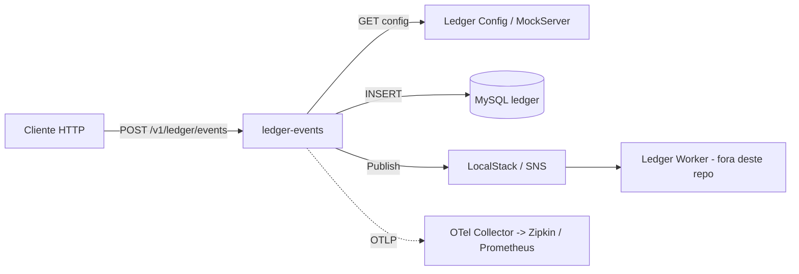

# 00 — Contexto e escopo

## Finalidade

`ledger-events` é um serviço Go que recebe pedidos de criação de eventos contábeis, resolve a configuração de processamento no **Ledger Config**, calcula as entradas (débito/crédito) a partir de valores e taxas, persiste o resultado no MySQL e publica o evento no SNS para processamento assíncrono pelo **Ledger Worker**.

## Fronteiras do sistema

### Responsabilidades

- Receber e correlacionar requisições HTTP.
- Buscar regras de cálculo no serviço de configuração.
- Aplicar regras de domínio (`regular` / `migration`) e validar o resultado.
- Persistir evento e entradas em uma transação.
- Publicar o evento calculado no tópico SNS.

### Fora do escopo

- Consumo de mensagens SQS, processamento assíncrono e liquidação contábil (fica com o Ledger Worker).
- Consulta, listagem ou auditoria de eventos já persistidos.
- Gestão de configs de processamento (fica com o Ledger Config).
- Autenticação/autorização de chamadores HTTP.

## Atores e sistemas participantes

| Nome | Tipo | Papel |
|---|---|---|
| Cliente HTTP | Ator externo | Envia `POST /v1/ledger/events` e consulta health |
| Ledger Config | Serviço HTTP | Fornece `scripts` com expressões por `flow` |
| MySQL `ledger` | Banco de dados | Armazena `event` e `entry` |
| SNS / LocalStack | Broker | Recebe o evento publicado |
| OTel Collector, Zipkin, Prometheus | Observabilidade | Recebem traços, logs e métricas |

## Glossário

| Termo | Significado neste projeto |
|---|---|
| Evento | Agregado raiz que representa uma operação contábil calculada |
| Entrada (`Entry`) | Linha contábil gerada por um script, com valor, débito e crédito |
| Produtor (`producer`) | Tipo de processamento: `regular` ou `migration` |
| `processing_code` | Código usado para localizar a config no Ledger Config |
| `program_id` | Segundo critério de localização da config |
| `cid` | Correlation id; propagado em spans, logs, banco e headers |
| `tenant` / `org_id` | Organização solicitante, propagada como `x-tenant` |
| Script | Regra de cálculo vinda do Ledger Config, com `flow` e `expression` |
| Fluxo (`flow`) | Chave que associa um script a um produtor |

## Fontes consultadas na engenharia reversa

| Fonte | Uso |
|---|---|
| `cmd/main.go`, `internal/infra/rest/server/server.go` | Entrypoint, rotas, middlewares, shutdown |
| `internal/infra/rest/ledger/*` | Contrato HTTP, headers, composição de dependências |
| `internal/application/events/*` | Orquestração, interfaces, mocks gerados |
| `internal/domain/events/*` | Regras de negócio e erros de domínio |
| `internal/infra/db/mysql/*`, `scripts/sql/init.sql` | Persistência e esquema |
| `internal/infra/ledger/config/*` | Cliente HTTP, circuit breaker, contrato de config |
| `internal/infra/message/*` | Publicação SNS e formato da mensagem |
| `config/config.go`, `.env` | Variáveis de ambiente e singleton de configuração |
| `Makefile`, `docker-compose.yaml`, `scripts/k8s/*`, `scripts/terraform/*` | Execução local, build e deploy |
| `docs/model/*.mmd` | Diagramas C4 de contexto, container, domínio e componente |

## Premissas

- `AS-IS`: as specs descrevem o comportamento do commit `396db3e`; mudanças de código exigem atualização deste pacote.
- O repositório não contém testes de integração com MySQL/SNS reais; comportamentos de infraestrutura foram inferidos do código e dos manifests.
- O projeto é um estudo de engenharia de backend, não uma plataforma financeira de produção.
