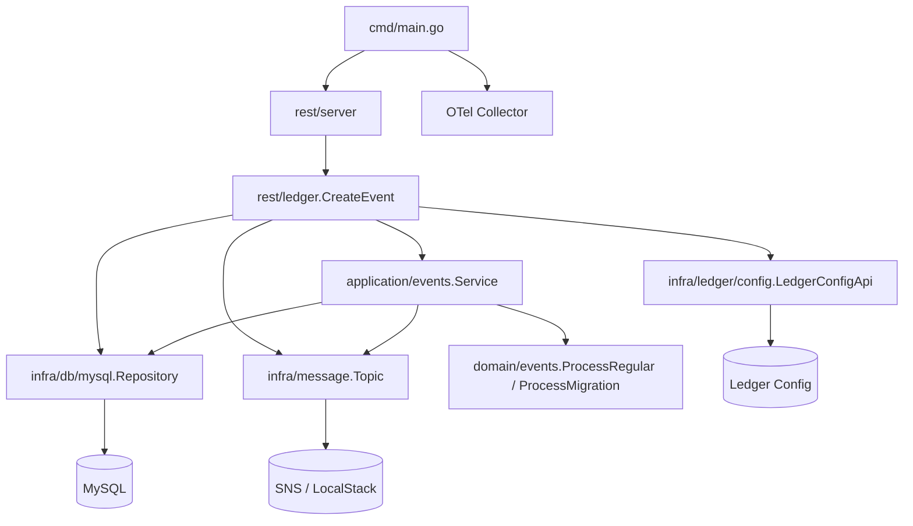
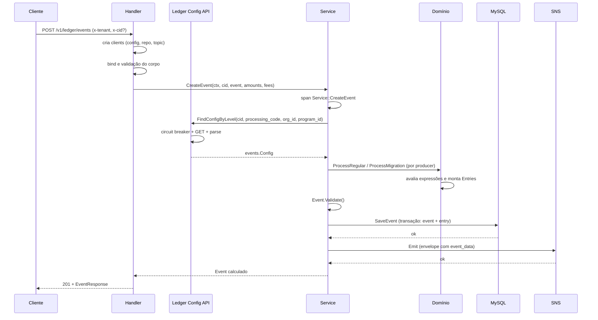

# Plano de Implementação: Criação e Publicação de Eventos Contábeis

**Branch**: `001-criacao-de-eventos` | **Data**: 2026-11-22 | **Spec**: [spec.md](spec.md)

**Entrada**: especificação derivada de `internal/`, `config/`, `scripts/` e `docs/model/`.

**Nota**: este plano descreve decisões **já presentes** no código; não é um plano a executar do zero.

## Resumo

Expor uma única rota de mutação que busca a configuração no Ledger Config, calcula entradas com expressões decimais, grava evento e entradas em uma transação MySQL e publica o resultado no SNS. A implementação usa Echo nos handlers, portas em `internal/application/events/interfaces.go`, mocks gerados por `mockgen` e clients de infraestrutura construídos a cada requisição.

## Contexto Técnico

**Linguagem/Versão**: Go 1.26.1 (`go.mod`)

**Dependências principais**: Echo v4.16.0, core-sdk v0.8.8 (logger/tracer/métricas/HTTP/SNS), `go-sql-driver/mysql`, `sony/gobreaker`, `shopspring/decimal`, `expr-lang/expr`, `google/uuid`, `testify`, `go.uber.org/mock` e `github.com/golang/mock` (legado)

**Armazenamento**: MySQL `ledger`; tabelas `event` e `entry`, chave primária composta em `entry`, `decimal(20,15)`

**Cliente de config**: HTTP instrumentado do core-sdk + circuit breaker `LedgerConfigAPI` (15s, >5 falhas)

**Mensageria**: SNS via core-sdk, tópico `EVENTS_SNS_TOPIC` (`events-sns-topic` no LocalStack)

**Testes**: `go test ./...` com mocks e `httptest`; integração manual com MySQL/MockServer/LocalStack

**Plataforma alvo**: serviço Linux em container (imagem Alpine), porta padrão `5001`

**Tipo de projeto**: serviço HTTP

**Metas de desempenho**: não declaradas no repositório; benchmarks `BenchmarkCreateEvent_Success` e `BenchmarkCreateEvent_Parallel` disponíveis em `internal/application/events/bench_test.go`

**Restrições**: sem CI, sem autenticação, sem outbox/retry; `config.New()` captura ambiente apenas uma vez; falhas de dependência são respondidas como `400`

**Escopo**: 1 rota de domínio (`POST /v1/ledger/events`), 2 tabelas, 1 cliente HTTP externo, 1 tópico SNS

### Fontes consultadas na engenharia reversa

| Fonte | Uso |
|---|---|
| `cmd/main.go`, `internal/infra/rest/server/server.go` | Entrypoint, rotas, middlewares, shutdown |
| `internal/infra/rest/ledger/*` | Contrato HTTP, headers, composição de dependências |
| `internal/application/events/*` | Orquestração, interfaces, mocks gerados |
| `internal/domain/events/*` | Regras de negócio e erros de domínio |
| `internal/infra/db/mysql/*`, `scripts/sql/init.sql` | Persistência e esquema |
| `internal/infra/ledger/config/*` | Cliente HTTP, circuit breaker, contrato de config |
| `internal/infra/message/*` | Publicação SNS e formato da mensagem |
| `config/config.go`, `.env` | Variáveis de ambiente e singleton de configuração |
| `Makefile`, `docker-compose.yaml`, `scripts/k8s/*`, `scripts/terraform/*` | Execução local, build e deploy |
| `docs/model/*.mmd` | Diagramas C4 de contexto, container, domínio e componente |

### Contrato HTTP (AS-IS)

Base URL local: `http://localhost:5001`. Requisições e respostas usam `application/json`, exceto os health checks. A versão legível por máquina está em [`../openapi.yaml`](../openapi.yaml).

| Método | Caminho | Finalidade | Sucesso | Falha |
|---|---|---|---|---|
| `POST` | `/v1/ledger/events` | Cria e publica um evento contábil | `201` | `400` |

**Headers**

| Header | Obrigatório na prática | Descrição |
|---|---|---|
| `x-tenant` | Não validado, mas esperado | Identificador da organização; vira `org_id` e é reenviado ao Ledger Config. |
| `x-cid` | Não | Correlation id. Quando ausente, o servidor gera um UUID. |

**Corpo da requisição**

| Campo | Tipo | Descrição |
|---|---|---|
| `processing_code` | string | Código da config no Ledger Config. |
| `program_id` | integer (int64) | Complemento da chave de configuração. |
| `account_id` | integer (int64) | Conta associada ao evento. |
| `producer` | string | `regular` ou `migration`. |
| `amounts` | objeto de decimais | Valores base das expressões, acessíveis como `Amounts`. |
| `fees` | objeto de decimais | Taxas das expressões, acessíveis como `Fees`. |

Exemplo compatível com as expectativas do MockServer local (`/v1/ledger/config/101/401`):

```json
{
  "processing_code": "101",
  "program_id": 401,
  "account_id": 123,
  "producer": "regular",
  "amounts": { "amount": 150.00 },
  "fees": { "iof": 15.99 }
}
```

Valores decimais podem vir como número ou string; a resposta serializa decimais como string (ex.: `"165.99"`).

**Resposta `201`**

```json
{
  "event_id": "9f1d...",
  "org_id": "TN-77add76c-e395-446b-b306-1a0f9cb99a31",
  "processing_code": "101",
  "program_id": 401,
  "account_id": 123,
  "description": "Compra a vista",
  "producer": "regular",
  "created_at": "2026-11-21T20:00:00Z",
  "entries": [
    {
      "entry_type_id": 101,
      "amount": "165.99",
      "debit_account": "",
      "credit_account": "",
      "description": "Compra a vista - Cartão"
    }
  ]
}
```

`event_id` e `created_at` são gerados pelo servidor; `description` vem da config; as contas vêm de `debit_account.number`/`credit_account.number` do script.

**Erros `400`**

| Situação | Mensagem | Origem |
|---|---|---|
| Falha ao vincular o corpo | `Bad Request` | Echo / `echo.ErrBadRequest` |
| Config não encontrada (`404`) | `ledger config not found` | `ErrResponse.Message` do cliente de config |
| Expressão inválida | `invalid expression: <expressão>` | core-sdk `expression.ErrInvalidExpression` |
| Erro ao avaliar expressão | `error on calculate: <detalhe>` | core-sdk `expression.ErrCalculateExpression` |
| Evento sem entradas | `entry not found to producer <producer>` | `domain/events.ErrEntryNotFound` |
| Config com status inesperado | `api error: status <código>` | `ledger_config.go` |
| JSON inválido do Ledger Config | `unmarshal error: ...` / `unmarshal erro: ...` | `ledger_config.go` (grafia inconsistente) |
| Erro de MySQL ou SNS | mensagem do driver / core-sdk | adapters de infraestrutura |

### Expressões

Compiladas e executadas por `core-sdk/pkg/expression`, baseado em `expr-lang`:

| Nome | Tipo | Origem |
|---|---|---|
| `Amounts` | `map[string]decimal.Decimal` | corpo da requisição (`amounts`) |
| `Fees` | `map[string]decimal.Decimal` | corpo da requisição (`fees`) |
| `Add`, `Sub`, `Mul`, `Div` | funções decimais | operadores sobrecarregados do core-sdk |
| `Sum` | função decimal | soma todos os valores de um mapa |

Exemplos nas expectativas do MockServer (`scripts/docker/mockserver/expectations.json`): `Amounts.amount + Fees.iof`, `Amounts.principal - Sum(Fees)`, `Amounts.amount / 2`, `Amounts.amount * -1`. Nomes no singular (`Amount`, `Fee`) não resolvem e causam erro de compilação.

### Mensagem publicada

O envelope do core-sdk SNS é montado em `internal/infra/message/service.go` com `EventID` UUID próprio, `EventType = "ledger"`, `EventData = ToEventMessage(e)` e `EventDate = time.Now()`. Os campos de `event_data` usam as tags de `internal/infra/message/types.go` — diferentes das tags da resposta HTTP:

```json
{
  "event_id": "<uuid gerado na publicação>",
  "event_type": "ledger",
  "event_data": {
    "event_id": "<event_id do domínio>",
    "org_id": "...",
    "processing_code": "...",
    "program_id": 401,
    "account_id": 123,
    "description": "...",
    "producer": "regular",
    "created_at": "...",
    "entries": [
      {
        "entrytype_id": 101,
        "amount": "165.99",
        "debit_account_id": "",
        "credit_account_id": "",
        "description": "..."
      }
    ]
  },
  "event_date": "..."
}
```

Na resposta HTTP as tags são `entry_type_id`, `debit_account` e `credit_account`; no envelope SNS são `entrytype_id`, `debit_account_id` e `credit_account_id`. Além disso, `ToEntryMessage` inicializa o slice com `make([]Entry, len(et))` e depois faz `append` (`OBS-01`).

## Verificação da Constituição

*GATE: aplicado antes de Phase 0 e reavaliado após o desenho.*

| Princípio | Situação | Evidência |
|---|---|---|
| I. Separação em camadas | Passa | Handler → Service → Domain; adapters em `internal/infra` |
| II. O domínio calcula, a interface transporta | Passa parcial | `ProcessRegular`/`ProcessMigration` no domínio; `EventRequest.Validate()` vazio (`OBS-04`) |
| III. Configuração singleton | Passa | `config/config.go`, com ressalva `OBS-10` |
| IV. Observabilidade no request | Passa | Interceptadores em `server.routes()` e spans com `cid` |
| V. Persistência transacional antes da publicação | Passa parcial | `SaveEvent` com tx; sem outbox (`OBS-11`) |
| VI. Testes unitários determinísticos | Passa | `services_test.go`, `bench_test.go`, `ledger_config_test.go` com `httptest` |
| VII. Infraestrutura como código | Passa | Compose, Terraform, k8s, Dockerfile; endpoint fixo (`OBS-09`) |

## Estrutura do Projeto

### Documentação (esta funcionalidade)

```text
docs/specs/001-criacao-de-eventos/
├── spec.md
├── plan.md
└── tasks.md
```

### Código-fonte (raiz do repositório)

```text
cmd/main.go
config/config.go
internal/
├── application/events/{services,interfaces,mock,bench_test,services_test}.go
├── domain/events/{event,entry,configs,processing,regular,migration,errors}.go
├── infra/
│   ├── db/mysql/{connection,repository,type}.go
│   ├── ledger/config/{ledger_config,response,errors,ledger_config_test}.go
│   ├── message/{service,types}.go
│   ├── rest/ledger/{handler,request,response}.go
│   ├── rest/server/server.go
│   └── rest/shared/{erros,interfaces}.go
scripts/sql/init.sql
scripts/docker/mockserver/expectations.json
docs/specs/openapi.yaml
```

**Decisão de estrutura**: monorepo Go único; caso de uso em `internal/application`, regras em `internal/domain`, transporte e adapters em `internal/infra`. Não há diretório `pkg` em uso.

## Fluxos e Decisões





Se qualquer etapa falhar, o erro sobe até o handler e é convertido em `400`. A transação faz rollback; o evento publicado permanece publicado caso a falha ocorra depois do `Emit`.

| Decisão | Consequência |
|---|---|
| Clients por requisição | Isolamento de conexões e circuit breaker por request; o breaker não acumula falhas entre chamadas. |
| Persistência antes da publicação | Evita publicar algo que não foi salvo, mas não garante publicação se o SNS falhar após o commit (`OBS-11`). |
| Config singleton com `sync.Once` | Valores de env fixados na primeira chamada; `With...` altera a instância compartilhada (`OBS-10`). |
| Interfaces com mocks gerados | A camada de aplicação é testável sem banco, SNS ou HTTP. |
| Sem tx outbox | Não há tabela de outbox, retry ou idempotência explícita no serviço. |
| Sem autenticação HTTP | O serviço confia no tenant informado no header. |

**Riscos estruturais**: `OBS-02` (repositório com `db == nil`), `OBS-03` (erros de `Commit` e de construção de tabela não tratados), `OBS-05` (`producer` fora do mapa) e `OBS-09` (provisionamento local de SNS dependente de IP fixo).

## Complexidade Conhecida

| Desvio | Por que existe | Alternativa mais simples considerada |
|---|---|---|
| `OBS-01`: `make` + `append` em `ToEntryMessage` | Código histórico nunca coberto por teste de payload | Construir o slice com capacidade (`make([]Entry, 0, len(et))`) e cobrir com teste |
| `OBS-02`: `NewRepository` devolve `&Repository{}` em falha de conexão | Construtor não propaga erro | Retornar erro explícito e tratá-lo no handler |
| `OBS-03`: erros de `buildEventTable` e `tx.Commit()` ignorados | Código herdado | Verificar ambos e fechar statements preparados |
| `OBS-04`: `evt.Validate()` sempre retorna `nil` | Tags `validate` declaradas, mas validador do Echo não é chamado | Chamar `c.Validate(evt)` no handler |
| `OBS-05`: `p[e.Producer]` sem checagem de chave | Mapa assume valores conhecidos | Validar `producer` contra `regular`/`migration` antes do despacho |
| `OBS-06`: todo erro do serviço vira `400` | Mapeador único no handler | Diferenciar `4xx` de `5xx` por tipo de erro |
| `OBS-11`: persistência e publicação separadas | Ausência de outbox | Avaliar outbox transacional ou idempotência + retry |
