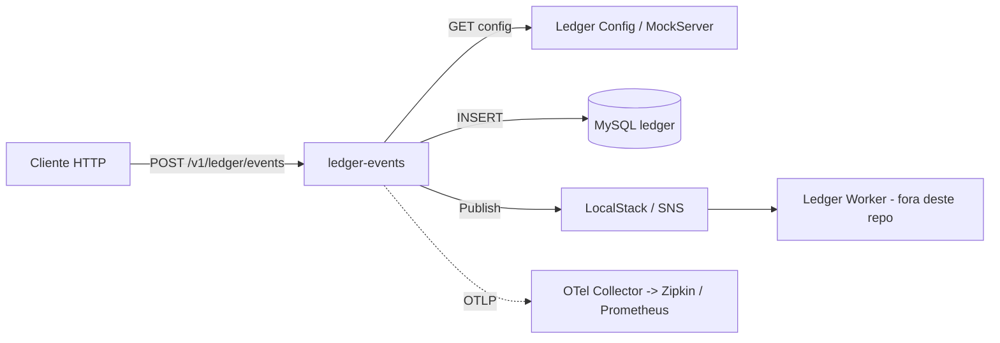
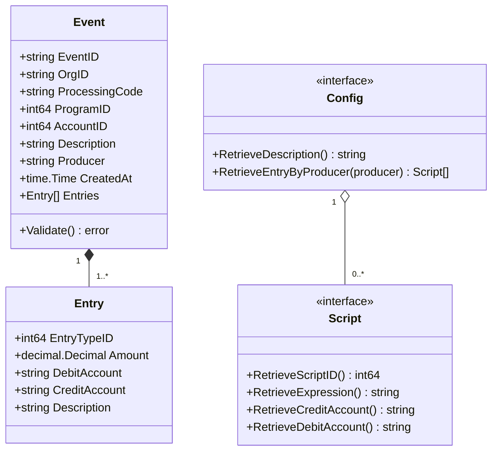

# Especificação da Funcionalidade: Criação e Publicação de Eventos Contábeis

**Branch da funcionalidade**: `001-criacao-de-eventos`

**Criado**: 2026-11-22

**Status**: Rascunho (derivado do código em `396db3e`)

**Entrada**: engenharia reversa de `internal/infra/rest/ledger`, `internal/application/events`, `internal/domain/events`, `internal/infra/{db/mysql,ledger/config,message}` e `scripts/docker/mockserver/expectations.json`

> **Escopo**: espelho `AS-IS` do fluxo `POST /v1/ledger/events`. `INFERIDO` marca intenção deduzida do código. Esta spec não prescreve mudanças; as lacunas aparecem como tarefas `[ ]` e na seção *Complexidade Conhecida* do plano.

## Contexto e Escopo

### Finalidade

`ledger-events` é um serviço Go que recebe pedidos de criação de eventos contábeis, resolve a configuração de processamento no **Ledger Config**, calcula as entradas (débito/crédito) a partir de valores e taxas, persiste o resultado no MySQL e publica o evento no SNS para processamento assíncrono pelo **Ledger Worker**.

### Fronteiras do sistema

### Responsabilidades

- Receber e correlacionar requisições HTTP.
- Buscar regras de cálculo no serviço de configuração.
- Aplicar regras de domínio (`regular` / `migration`) e validar o resultado.
- Persistir evento e entradas em uma transação.
- Publicar o evento calculado no tópico SNS.

### Fora do escopo

- Consumo de mensagens SQS, processamento assíncrono e liquidação contábil (fica com o Ledger Worker).
- Consulta, listagem ou auditoria de eventos já persistidos.
- Gestão de configs de processamento (fica com o Ledger Config).
- Autenticação/autorização de chamadores HTTP.

### Atores e sistemas participantes

| Nome | Tipo | Papel |
|---|---|---|
| Cliente HTTP | Ator externo | Envia `POST /v1/ledger/events` e consulta health |
| Ledger Config | Serviço HTTP | Fornece `scripts` com expressões por `flow` |
| MySQL `ledger` | Banco de dados | Armazena `event` e `entry` |
| SNS / LocalStack | Broker | Recebe o evento publicado |
| OTel Collector, Zipkin, Prometheus | Observabilidade | Recebem traços, logs e métricas |

### Glossário

| Termo | Significado neste projeto |
|---|---|
| Evento | Agregado raiz que representa uma operação contábil calculada |
| Entrada (`Entry`) | Linha contábil gerada por um script, com valor, débito e crédito |
| Produtor (`producer`) | Tipo de processamento: `regular` ou `migration` |
| `processing_code` | Código usado para localizar a config no Ledger Config |
| `program_id` | Segundo critério de localização da config |
| `cid` | Correlation id; propagado em spans, logs, banco e headers |
| `tenant` / `org_id` | Organização solicitante, propagada como `x-tenant` |
| Script | Regra de cálculo vinda do Ledger Config, com `flow` e `expression` |
| Fluxo (`flow`) | Chave que associa um script a um produtor |

## Cenários de Usuário e Testes *(obrigatório)*

### História de Usuário 1 - Receber e correlacionar a requisição (Prioridade: P1)

Um serviço consumidor envia um evento contábil com valores e taxas, identificando a organização e, opcionalmente, o correlation id.

**Por que esta prioridade**: sem o recebimento e a correlação corretos, nenhuma das etapas seguintes pode ser rastreada.

**Teste independente**: enviar `POST /v1/ledger/events` com `x-tenant` e sem `x-cid` contra o MockServer/LocalStack; verificar que o servidor gera um UUID e o propaga até a coluna `correlation_id`.

**Cenários de aceitação**:

1. **Dado** um corpo JSON válido e `x-tenant: TN-77add76c-...`, **Quando** a requisição chega, **Então** o handler vincula `EventRequest` e usa o tenant como `Event.OrgID`.
2. **Dado** um `x-cid` presente, **Quando** a requisição é processada, **Então** esse valor é usado como correlation id em spans, logs e no parâmetro `cid` do serviço.
3. **Dado** `x-cid` ausente, **Quando** a requisição é processada, **Então** o servidor gera `uuid.NewString()` (`FR-02`).
4. **Dado** um corpo inválido na vinculação, **Quando** o bind falha, **Então** o servidor responde `400` com `{"message": "Bad Request"}`.
5. **Dado** um `x-tenant` ausente, **Quando** a requisição é processada, **Então** o tenant vira string vazia: o header é lido, mas não validado (`INFERIDO`).

---

### História de Usuário 2 - Resolver a configuração no Ledger Config (Prioridade: P1)

O caso de uso precisa das regras de cálculo aplicáveis ao par `processing_code`/`program_id` da organização.

**Por que esta prioridade**: as entradas não podem ser calculadas sem as expressões e a descrição vindas da config.

**Teste independente**: configurar o MockServer com a expectativa `/v1/ledger/config/101/401` e verificar a chamada com os headers `x-cid` e `x-tenant`.

**Cenários de aceitação**:

1. **Dado** `processing_code = 101` e `program_id = 401`, **Quando** o serviço consulta a config, **Então** é feito `GET {LEDGER_CONFIG_API_URL}/v1/ledger/config/101/401` com `x-cid` e `x-tenant`.
2. **Dado** uma resposta `404` do Ledger Config, **Quando** o cliente a interpreta, **Então** o erro `ledger config not found` chega ao handler e a resposta é `400`.
3. **Dado** um status HTTP inesperado, **Quando** o cliente o recebe, **Então** a mensagem é `api error: status <código>`.
4. **Dado** um JSON inválido vindo do Ledger Config, **Quando** o cliente faz o unmarshal, **Então** a mensagem é `unmarshal error: ...` ou `unmarshal erro: ...` — grafia inconsistente preservada.
5. **Dado** mais de 5 falhas consecutivas, **Quando** o circuit breaker `LedgerConfigAPI` atua, **Então** ele fica aberto por `15s` e o cliente é recriado a cada request.

---

### História de Usuário 3 - Calcular as entradas com as regras de domínio (Prioridade: P1)

O serviço transforma os scripts da config e os valores da requisição nas linhas contábeis do evento.

**Por que esta prioridade**: é a regra de negócio central e o único ponto onde valores monetários são produzidos.

**Teste independente**: com `amounts.amount = 150`, `fees.iof = 15.99` e `producer = regular`, verificar uma entrada de `165.99` quando o script usa `Amounts.amount + Fees.iof`.

**Cenários de aceitação**:

1. **Dado** `producer = regular`, **Quando** o despacho ocorre, **Então** `ProcessRegular` é escolhido; com `migration`, `ProcessMigration`.
2. **Dado** scripts da config, **Quando** as entradas são geradas, **Então** apenas aqueles com `flow == producer` produzem entradas.
3. **Dado** um script elegível, **Quando** sua expressão é avaliada, **Então** é criada uma `Entry` com `EntryTypeID = script_id`, valor decimal, descrição e contas do script.
4. **Dado** nenhum script com o `flow` do produtor, **Quando** o evento é validado, **Então** `ErrEntryNotFound` produce `entry not found to producer <producer>` e a resposta é `400`.
5. **Dado** uma expressão com `Amount` ou `Fee` no singular, **Quando** ela é compilada, **Então** ocorre erro: o ambiente expõe somente `Amounts` e `Fees`.
6. **Dado** `producer` fora de `regular`/`migration`, **Quando** o mapa de processadores é consultado, **Então** o valor é `nil` e a chamada falha — não há validação explícita (`OBS-05`).

---

### História de Usuário 4 - Persistir evento e entradas em uma transação (Prioridade: P1)

O resultado calculado precisa ser gravado de forma atômica antes de qualquer publicação.

**Por que esta prioridade**: entradas órfãs ou um evento sem entradas deixariam o ledger inconsistente.

**Teste independente** (com MySQL local): enviar um evento válido e conferir uma linha em `event` e N linhas em `entry` com o mesmo `event_id`; simular erro em um `INSERT` e verificar rollback.

**Cenários de aceitação**:

1. **Dado** um evento válido, **Quando** `SaveEvent` é chamado, **Então** `event` e todas as `entry` são gravadas na mesma transação e confirmadas com `Commit`.
2. **Dado** uma falha em qualquer `INSERT`, **Quando** a transação termina, **Então** o `defer tx.Rollback()` desfaz toda a gravação.
3. **Dado** `event_id` UUID gerado no mapeamento da requisição, **Quando** a gravação ocorre, **Então** ele vira a chave primária de `event` e é repetido em cada `entry` (`BR-01`).
4. **Dado** a coluna `updated_at`, **Quando** a gravação ocorre, **Então** ela permanece nula: o código não a preenche.
5. **Dado** um valor acima da precisão `decimal(20,15)`, **Quando** o MySQL grava, **Então** pode ocorrer erro de arredondamento.

---

### História de Usuário 5 - Publicar o evento e responder ao cliente (Prioridade: P1)

Após gravar, o serviço publica o evento para o Ledger Worker e devolve o resultado calculado.

**Por que esta prioridade**: fecha o caso de uso e é a fronteira com o processamento assíncrono.

**Teste independente**: com mocks, verificar que `Emit` é chamado após `SaveEvent`, com envelope `event_type = "ledger"`, e que a resposta HTTP é `201` com o evento calculado.

**Cenários de aceitação**:

1. **Dado** um evento persistido, **Quando** `Topic.Emit` é chamado, **Então** a mensagem contém `event_id`, `event_type = "ledger"`, `event_data` e `event_date`.
2. **Dado** uma falha no SNS, **Quando** `Emit` retorna erro, **Então** o handler responde `400` e o evento permanece persistido — não há compensação.
3. **Dado** sucesso em todas as etapas, **Quando** o handler responde, **Então** o status é `201` e o corpo segue `EventResponse`, com decimais serializados como string (ex.: `"165.99"`).
4. **Dado** qualquer erro do serviço (config, expressão, validação, persistência ou publicação), **Quando** ele chega ao handler, **Então** a resposta é `400` com `{"message": "<erro>"}`.
5. **Dado** um script sem contas informadas, **Quando** a resposta é montada, **Então** `debit_account` e `credit_account` vêm como strings vazias.

---

### Casos Limite

- Ausência de `x-cid`: UUID gerado; ausência de `x-tenant`: `org_id` vazio, sem rejeição.
- `producer` desconhecido não é validado (`OBS-05`); scripts com `flow` diferente são ignorados.
- `entry` tem chave primária composta `(event_id, entry_type_id)`: dois scripts com o mesmo `script_id` para um evento colidem.
- `updated_at` nunca é preenchido; falhas de `Commit` e de construção de tabela não são tratadas (`OBS-03`).
- `NewRepository` pode devolver `db == nil` em vez de erro (`OBS-02`).
- `ToEntryMessage` gera N entradas vazias antes das reais no envelope SNS (`OBS-01`).
- A collection Postman antiga usa `/v1/accounting/events` e não é contrato válido (`OBS-08`).

## Requisitos *(obrigatório)*

### Requisitos Funcionais

- **FR-001**: O sistema DEVE aceitar `POST /v1/ledger/events` com corpo JSON vinculado a `EventRequest`. *(FR-01)*
- **FR-002**: O sistema DEVE gerar `x-cid` como UUID quando o header estiver ausente. *(FR-02)*
- **FR-003**: O sistema DEVE propagar `x-tenant` para `Event.OrgID` e para o header da consulta ao Ledger Config. *(FR-03)*
- **FR-004**: O sistema DEVE buscar a config por `processing_code` e `program_id` em `{LEDGER_CONFIG_API_URL}/v1/ledger/config/{processing_code}/{program_id}`. *(FR-04)*
- **FR-005**: O sistema DEVE selecionar o processador pelo campo `producer` (`regular` → `ProcessRegular`, `migration` → `ProcessMigration`). *(FR-05)*
- **FR-006**: O sistema DEVE calcular uma `Entry` por script com `flow == producer`, avaliando `expression` com `Amounts` e `Fees`. *(FR-06)*
- **FR-007**: O sistema DEVE rejeitar eventos sem ao menos uma entrada. *(FR-07)*
- **FR-008**: O sistema DEVE gravar evento e entradas em uma única transação MySQL, com rollback em caso de erro. *(FR-08)*
- **FR-009**: O sistema DEVE publicar o evento no SNS somente após a persistência, com envelope `event_id`, `event_type`, `event_data` e `event_date`. *(FR-09)*
- **FR-010**: O sistema DEVE responder `201` com `EventResponse` quando o caso de uso termina com sucesso. *(FR-10)*
- **FR-011**: O sistema DEVE representar falhas como `{"message": "..."}` com status `400`, inclusive falhas de dependências externas. *(FR-11, OBS-06)*
- **FR-012**: O sistema DEVE usar o cliente HTTP instrumentado do `core-sdk` com headers e tratamento de `404` para consultar o Ledger Config. *(IR-01)*
- **FR-013**: O sistema DEVE aplicar circuit breaker `LedgerConfigAPI` com timeout de `15s` e abertura após mais de 5 falhas consecutivas. *(IR-02)*
- **FR-014**: O sistema DEVE publicar via `sns.NewPublisher(ctx, config.New())` no tópico `EVENTS_SNS_TOPIC`. *(IR-03)*
- **FR-015**: O sistema DEVE usar `shopspring/decimal` para valores monetários, com coluna `decimal(20,15)`. *(NFR-06)*

### Entidades Principais

`Config` e `Script` são interfaces de domínio implementadas pelos DTOs `ConfigResponse`/`ScriptResponse` do cliente Ledger Config, mantendo as regras desacopladas do JSON externo.

Regras de negócio observadas:

| ID | Regra | Rastreabilidade |
|---|---|---|
| BR-01 | `event_id` é UUID gerado no mapeamento da requisição, não pelo cliente. | `rest/ledger/request.go::ToEntity` |
| BR-02 | `created_at` é o instante do mapeamento da requisição. | `rest/ledger/request.go::ToEntity` |
| BR-03 | `org_id` do evento é o header `x-tenant`. | `rest/ledger/request.go::ToEntity` |
| BR-04 | A descrição do evento é `Config.RetrieveDescription()`. | `regular.go`, `migration.go` |
| BR-05 | Somente scripts cujo `flow` seja igual ao `producer` geram entradas. | `ledger/config/response.go::RetrieveEntryByProducer` |
| BR-06 | Cada script gera entrada com `EntryTypeID = script_id`, valor da expressão, descrição e contas do script. | `regular.go`, `migration.go` |
| BR-07 | Contas são o campo `number` de `debit_account`/`credit_account`, ou string vazia. | `ledger/config/response.go` |
| BR-08 | Um evento é válido somente com pelo menos uma entrada. | `domain/events/event.go::Validate` |
| BR-09 | Ordem: config → cálculo → validação → persistência → publicação. | `application/events/services.go::CreateEvent` |

Erros de domínio e de expressão: `ErrScriptNotFound` (`ledger config not found`), `ErrEntryNotFound` (`entry no found` no tipo; instanciado como `entry not found to producer <producer>` no serviço), `ErrInvalidExpression` (`invalid expression: <expr>`), `ErrCalculateExpression` (`error on calculate: <detalhe>`). Os erros de domínio não usados no fluxo foram removidos na spec 005.

## Critérios de Sucesso *(obrigatório)*

### Resultados Mensuráveis

- **SC-001**: 100% das requisições com payload válido retornam `201` com `event_id` no formato UUID.
- **SC-002**: 100% das requisições sem `x-cid` recebem um UUID propagado até a coluna `correlation_id`.
- **SC-003**: Em 100% dos casos, somente scripts com `flow == producer` geram entradas.
- **SC-004**: Toda falha antes do `Commit` deixa `event` e `entry` sem linhas gravadas.
- **SC-005**: 100% dos eventos publicados usam `event_type = "ledger"` e contêm o `event_id` do domínio em `event_data`.
- **SC-006**: Expressões com `Amounts`/`Fees` produzem valores decimais exatos; nomes no singular falham na compilação.
- **SC-007**: 100% das falhas do caso de uso são convertidas em `400` com o corpo `{"message": "..."}`.

## Suposições

- `x-tenant` é confiável: não há autenticação ou autorização no serviço.
- Ledger Config, MySQL e SNS/LocalStack estão disponíveis conforme `platform.md`.
- Consumidores aceitam o corpo de erro único `{"message": "..."}`, inclusive para erros de dependência.
- O Ledger Worker consome o tópico SNS `events-sns-topic` e é responsável pelo processamento assíncrono.
- O contrato executável é o código; `openapi.yaml` é um espelho e a collection Postman está desatualizada (`OBS-08`).
- Não há testes de integração na suíte padrão; comportamentos de infraestrutura foram inferidos do código e dos manifests.
