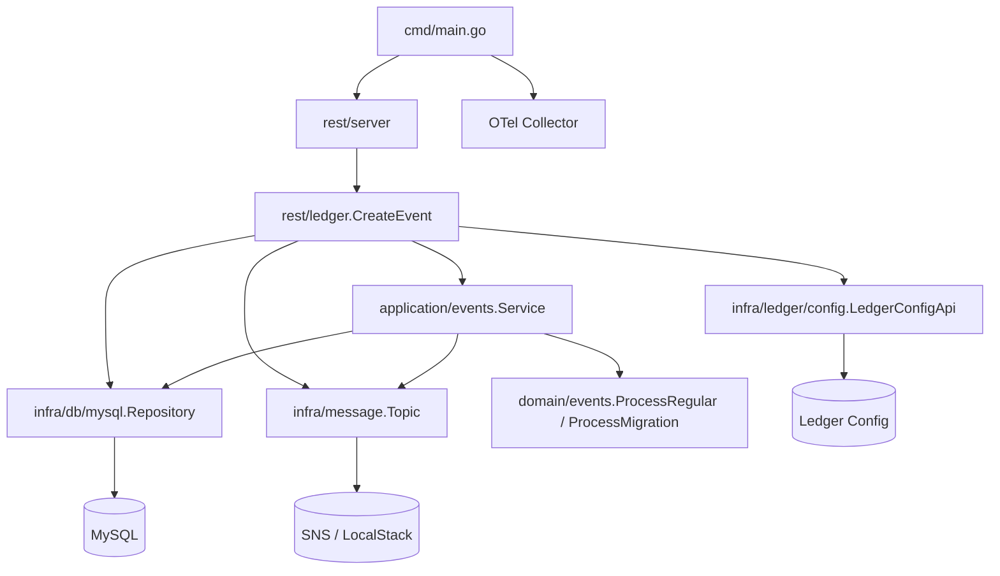
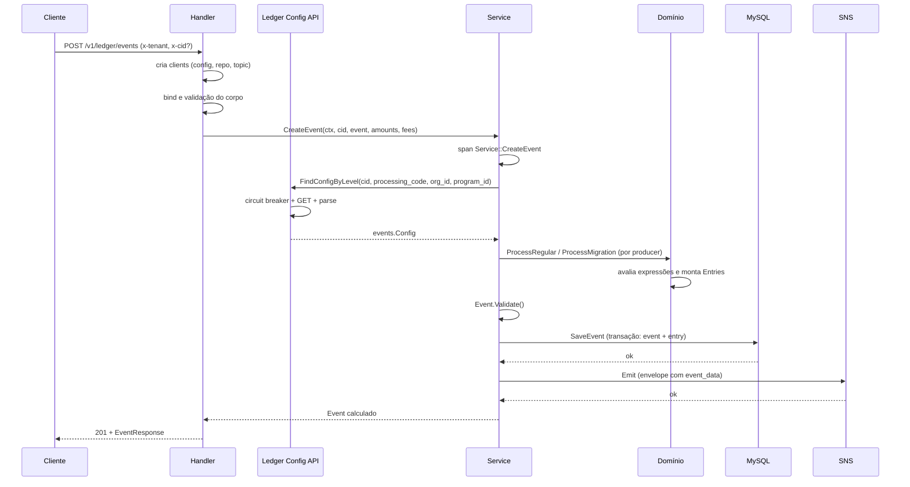

# 02 — Arquitetura e fluxos

## Visão em camadas

| Camada | Pacotes | Responsabilidade | Depende de |
|---|---|---|---|
| Entrypoint | `cmd` | Inicializa OTel, servidor HTTP e shutdown | `config`, `infra/rest/server` |
| Configuração | `config` | Carrega env e expõe `Config` (singleton) | core-sdk `env` |
| Apresentação | `internal/infra/rest` | Rotas, middlewares, bind, DTOs, composição dos clients | `application`, adapters de infra |
| Aplicação | `internal/application/events` | Orquestra o caso de uso de criação de evento | interfaces + domínio |
| Domínio | `internal/domain/events` | Modelo, regras de cálculo e validação | core-sdk `expression`, `decimal` |
| Infraestrutura | `internal/infra/db`, `ledger/config`, `message` | MySQL, Ledger Config HTTP, SNS | `config`, domínio |

A seta de dependência principal aponta de `infra/rest` para `application`, que depende apenas das interfaces `Repository`, `ConfigProvider` e `Topic`. O domínio não conhece HTTP, SQL ou AWS.

## Componentes

Os clients de infraestrutura são criados **por requisição** no handler (`configApi.New`, `mysql.NewRepository`, `message.New`) e fechados ao final dela.

## Fluxo: criação de evento

Se qualquer etapa falhar, o erro sobe até o handler e é convertido em `400` com `{"message": "..."}`. A transação de banco faz rollback; o evento publicado permanece publicado caso a falha ocorra depois do `Emit` (não há compensação).

## Fluxo: prontidão

`GET /health/ready` cria um repositório MySQL e um publisher SNS a cada chamada, executa `PingContext` e `GetTopicAttributes`, e responde `503` sem corpo se qualquer verificação falhar. `GET /health/live` apenas responde `200`.

## Fluxo: desligamento

`main` aguarda `SIGINT`/`SIGTERM`, cria um contexto com timeout de 25 segundos, chama `Server.Shutdown` e depois `otel.Shutdown`. Erros são apenas impressos no stdout; o processo termina com status `0`.

## Decisões implícitas

| Decisão | Consequência |
|---|---|
| Clients por requisição | Isolamento de conexões e circuit breaker por request; o breaker não acumula falhas entre chamadas. |
| Persistência antes da publicação | Evita publicar algo que não foi salvo, mas não garante publicação se o SNS falhar após o commit (ver `OBS-11`). |
| Config singleton com `sync.Once` | Valores de env são fixados na primeira chamada; `With...` altera a instância compartilhada (ver `OBS-10`). |
| Interfaces com mocks gerados | A application layer é testável sem banco, SNS ou HTTP. |
| Sem tx outbox | Não há tabela de outbox, retry ou idempotência explícita no serviço. |
| Sem autenticação HTTP | O serviço confia no tenant informado no header (ver `INFERIDO` em `01-requisitos.md`). |

## Riscos estruturais

- `OBS-02`: falha de conexão com MySQL produce um repositório com `db == nil` em vez de erro explícito.
- `OBS-03`: erros de `Commit` e de construção da tabela não são tratados em `SaveEvent`.
- `OBS-05`: `producer` fora do mapa de processadores não gera erro de domínio.
- `OBS-09`: o provisionamento local de SNS depende de um endereço fixo de LocalStack.
