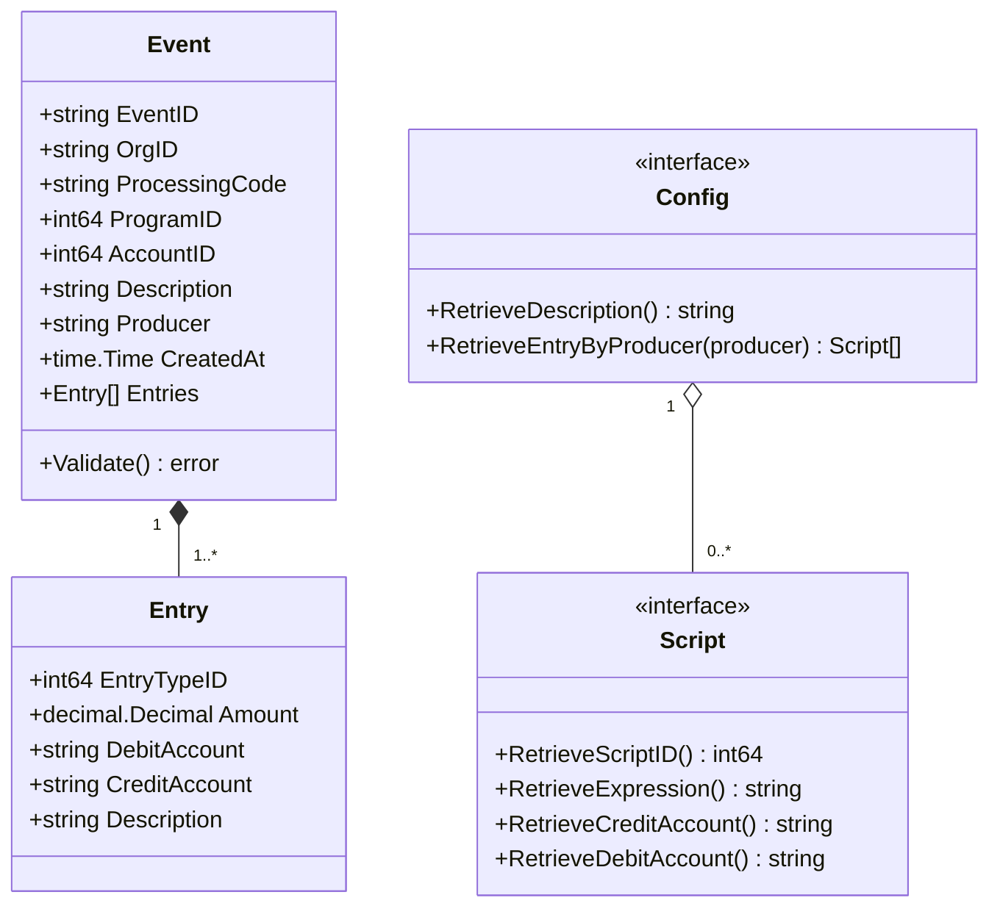

# 04 — Modelo de domínio e regras de negócio

## Modelo



`Config` e `Script` são interfaces de domínio implementadas pelos DTOs do cliente Ledger Config (`ConfigResponse` e `ScriptResponse`). Isso mantém as regras de cálculo desacopladas do JSON externo.

## Produtores e processadores

| Constante | Valor | Processador |
|---|---|---|
| `Regular` | `regular` | `ProcessRegular` |
| `Migration` | `migration` | `ProcessMigration` |

A seleção ocorre via mapa em `internal/application/events/services.go`: `p[e.Producer](config, &event, amounts, fees)`.

## Regras de negócio

| ID | Regra | Rastreabilidade |
|---|---|---|
| BR-01 | O `event_id` é um UUID gerado no mapeamento da requisição, não pelo cliente. | `rest/ledger/request.go::ToEntity` |
| BR-02 | O `created_at` é o instante do mapeamento da requisição. | `rest/ledger/request.go::ToEntity` |
| BR-03 | O `org_id` do evento é o header `x-tenant`. | `rest/ledger/request.go::ToEntity` |
| BR-04 | A descrição do evento é `Config.RetrieveDescription()`. | `regular.go`, `migration.go` |
| BR-05 | Somente scripts cujo `flow` seja igual ao `producer` geram entradas. | `ledger/config/response.go::RetrieveEntryByProducer` |
| BR-06 | Cada script gera uma entrada com `EntryTypeID = script_id`, `Amount = resultado da expressão`, descrição e contas do script. | `regular.go`, `migration.go` |
| BR-07 | Contas de débito/crédito são o campo `number` dos objetos `debit_account`/`credit_account`, ou string vazia se ausentes. | `ledger/config/response.go::RetrieveCreditAccount/DebitAccount` |
| BR-08 | Um evento é válido somente com pelo menos uma entrada. | `domain/events/event.go::Validate` |
| BR-09 | A ordem de processamento é: config → cálculo → validação → persistência → publicação. | `application/events/services.go::CreateEvent` |

`ProcessRegular` e `ProcessMigration` têm implementação idêntica; diferem apenas do `flow` usado para filtrar scripts.

## Expressões

As expressões são compiladas e executadas por `core-sdk/pkg/expression`, baseado em `expr-lang`. O ambiente disponível é:

| Nome | Tipo | Origem |
|---|---|---|
| `Amounts` | `map[string]decimal.Decimal` | corpo da requisição (`amounts`) |
| `Fees` | `map[string]decimal.Decimal` | corpo da requisição (`fees`) |
| `Add`, `Sub`, `Mul`, `Div` | funções decimais | operadores sobrecarregados do core-sdk |
| `Sum` | função decimal | soma todos os valores de um mapa |

Exemplos presentes nas expectativas do MockServer (`scripts/docker/mockserver/expectations.json`):

- `Amounts.amount + Fees.iof`
- `Amounts.principal - Sum(Fees)`
- `Amounts.amount / 2`
- `Amounts.amount * -1`

Exemplo numérico: com `amounts.amount = 150`, `fees.iof = 15.99` e `producer = regular`, a expressão `Amounts.amount + Fees.iof` gera uma entrada de `165.99`.

Nomes no singular (`Amount`, `Fee`) não fazem parte do ambiente e causam erro de compilação da expressão.

## Erros de domínio

| Tipo | Mensagem padrão | Observação |
|---|---|---|
| `ErrScriptNotFound` | `ledger config not found` | Definido no domínio e usado nos mocks; no caminho HTTP, a mensagem vem do `ErrResponse` do cliente de config. |
| `ErrEntryNotFound` | `entry no found` | No serviço é instanciado com `entry not found to producer <producer>`. |
| `ErrInvalidExpression` | `invalid expression: <expr>` | Definido no core-sdk. |
| `ErrCalculateExpression` | `error on calculate: <detalhe>` | Definido no core-sdk. |
| `ErrDuplicatedEntry`, `ErrDuplicatedAccount` | `duplicated entry`, `duplicated account type` | Definidos no domínio, mas não usados no fluxo atual. |

## Mensagem publicada

O evento é convertido para o envelope do core-sdk SNS:

```json
{
  "event_id": "<uuid gerado na publicação>",
  "event_type": "ledger",
  "event_data": {
    "event_id": "<event_id do domínio>",
    "org_id": "...",
    "processing_code": "...",
    "program_id": 401,
    "account_id": 123,
    "description": "...",
    "producer": "regular",
    "created_at": "...",
    "entries": []
  },
  "event_date": "..."
}
```

Atenção: `ToEntryMessage` em `internal/infra/message/types.go` inicializa o slice com `make([]Entry, len(et))` e depois faz `append`, produzindo entradas vazias à frente das reais. O comportamento observado está registrado como `OBS-01`.
