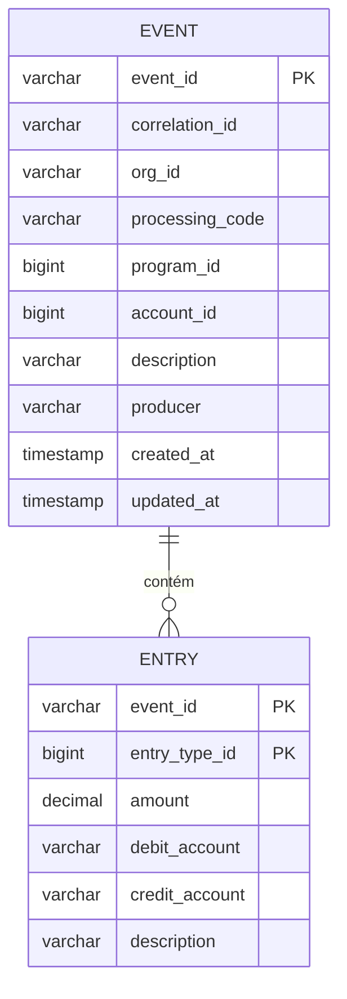

# 05 — Modelo de dados

## Esquema MySQL

Fonte: `scripts/sql/init.sql` (usado pelo `docker compose` via `docker-entrypoint-initdb.d`). O mesmo DDL aparece no ConfigMap `ledger-schema` em `scripts/k8s/configmap.yaml` (ver `OBS-07`).

```sql
CREATE TABLE IF NOT EXISTS event(
    event_id varchar(50) primary key,
    correlation_id varchar(50) not null,
    org_id varchar(60) not null,
    processing_code varchar(100),
    program_id bigint not null,
    account_id bigint not null,
    description varchar(200) not null,
    producer varchar(100) not null,
    created_at timestamp,
    updated_at timestamp
);

CREATE TABLE IF NOT EXISTS entry(
    event_id varchar(50) not null,
    entry_type_id bigint not null,
    amount decimal(20, 15) not null,
    debit_account varchar(60),
    credit_account varchar(60),
    description varchar(200) not null,
    primary key(event_id, entry_type_id)
);
```

Não há ferramenta de migração: o schema é aplicado uma vez na inicialização do MySQL local ou pelo init container `init-db` no Kubernetes.

## Relacionamento



A chave primária composta de `entry` impede dois scripts com o mesmo `script_id` para um mesmo evento.

## Mapeamento objeto-relacional

| Coluna | Origem no domínio | Observação |
|---|---|---|
| `event.event_id` | `Event.EventID` | UUID gerado no handler |
| `event.correlation_id` | parâmetro `cid` do serviço | header `x-cid` ou UUID gerado |
| `event.org_id` | `Event.OrgID` | header `x-tenant` |
| `event.processing_code` | `Event.ProcessingCode` | corpo da requisição |
| `event.program_id` | `Event.ProgramID` | corpo da requisição |
| `event.account_id` | `Event.AccountID` | corpo da requisição |
| `event.description` | `Event.Description` | descrição vinda da config |
| `event.producer` | `Event.Producer` | `regular` ou `migration` |
| `event.created_at` | `Event.CreatedAt` | `time.Now()` no mapeamento da requisição |
| `event.updated_at` | — | declarada no schema, não preenchida pelo código |
| `entry.event_id` | `Event.EventID` | repetida em cada entrada |
| `entry.entry_type_id` | `Entry.EntryTypeID` | `script_id` da config |
| `entry.amount` | `Entry.Amount` | `decimal.Decimal`; coluna `decimal(20,15)` |
| `entry.debit_account` | `Entry.DebitAccount` | `number` da conta de débito, ou vazio |
| `entry.credit_account` | `Entry.CreditAccount` | `number` da conta de crédito, ou vazio |
| `entry.description` | `Entry.Description` | descrição do script |

O mapeamento está em `internal/infra/db/mysql/type.go` (`buildEventTable`, `buildEntryTable`).

## Transação de gravação

`Repository.SaveEvent` (`internal/infra/db/mysql/repository.go`):

1. `BeginTx` com contexto da requisição.
2. `INSERT INTO event (...)` com 9 colunas (não inclui `updated_at`).
3. Um `INSERT INTO entry (...)` por entrada calculada.
4. `Commit`. Em qualquer erro anterior, o `defer tx.Rollback()` desfaz a transação.

A conexão é obtida por `config.New().GetMySQLConnectionString()`, no formato `user:pass@tcp(host:port)/db?charset=utf8&parseTime=True&loc=Local`.

## Observações de dados

- `buildEventTable` e `buildEntryTable` atualmente nunca retornam erro, mas o primeiro erro é descartado em `SaveEvent` (`OBS-03`).
- O erro de `tx.Commit()` não é verificado (`OBS-03`).
- `NewRepository` retorna uma estrutura com `db == nil` quando a conexão falha, em vez de propagar o erro (`OBS-02`).
- Não há leitura de eventos persistidos; o banco é usado apenas para escrita e health check.
- Precisão: `decimal(20,15)` permite 5 dígitos inteiros e 15 decimais; valores maiores podem causar erro de arredondamento no MySQL.
