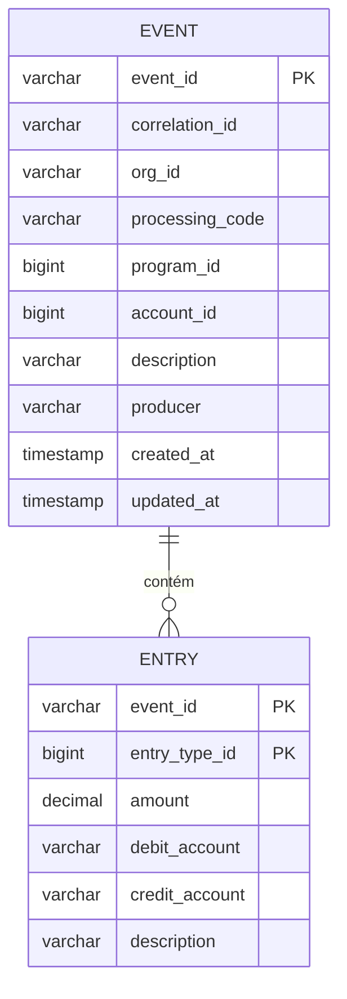

# Contexto Técnico — Ledger Events

Documento de apoio às specs, derivado de `go.mod`, `config/config.go`, `docker-compose.yaml`, `scripts/`, `Makefile` e `AGENTS.md`.

## Stack

| Item | Versão/configuração |
|---|---|
| Linguagem | Go 1.26.1 (`go.mod`); imagem `scripts/docker/api/Dockerfile` (Go + Alpine) |
| HTTP | Echo v4.16.0 |
| Persistência | MySQL via `go-sql-driver/mysql` v1.10.1; schema em `scripts/sql/init.sql` |
| Eventos | SNS via `core-sdk` v0.8.8 e AWS SDK v2 (`service/sns`) |
| Config client | HTTP instrumentado do `core-sdk` + `sony/gobreaker` v1.0.0 |
| Expressões | `core-sdk/pkg/expression` sobre `expr-lang/expr` v1.17.8 |
| Valores monetários | `shopspring/decimal` v1.5.0; coluna `decimal(20,15)` |
| Observabilidade | OpenTelemetry 1.47 (traces/métricas) e logger Zap do `core-sdk` |
| Validação | `go-playground/validator` v9 + `EntityRequest.Validate()` |
| Testes | `stretchr/testify` v1.12.1 e `go.uber.org/mock` v0.6.0 (mockgen); fakes in-memory nas portas e `httptest` nos adapters HTTP |

## Configuração

Fonte: `config/config.go` e `.env` (gitignored). `make run` exporta o `.env` antes de executar a aplicação.

| Variável | Default no código | Valor de desenvolvimento |
|---|---|---|
| `APP_PORT` | `5001` | não definido no `.env` |
| `MYSQL_HOST` | `""` | `localhost` |
| `MYSQL_PORT` | `""` | `3306` |
| `MYSQL_DATABASE` | `""` | `ledger` |
| `MYSQL_USER` | `""` | `admin` |
| `MYSQL_PASSWORD` | `""` | `adminpassword` |
| `AWS_ADDRESS` | `""` | `http://localhost:4566` |
| `AWS_REGION` | `""` | `us-east-1` |
| `AWS_ACCESS_KEY_ID` | `""` | `test` |
| `AWS_SECRET_ACCESS_KEY` | `""` | `test` |
| `EVENTS_SNS_TOPIC` | `""` | `arn:aws:sns:us-east-1:000000000000:events-sns-topic` |
| `LEDGER_CONFIG_API_URL` | `""` | `http://localhost:1080` |
| `OTEL_EXPORTER_OTLP_ENDPOINT` | — | `localhost:4317` |
| `OTEL_SERVICE_NAME` | — | `ledger-events` |

`config.New()` é singleton (`sync.Once`): a primeira chamada fixa os valores lidos do ambiente. As opções `WithAppPort`, `WithAwsAddress`, `WithAwsRegion` e `WithLedgerConfigApiUrl` alteram a instância compartilhada (`OBS-10`). Um `go run ./cmd/...` direto não carrega o `.env`; apenas `APP_PORT` tem default no código.

## Modelo de dados

Fonte: `scripts/sql/init.sql` (aplicado pelo `docker compose` via `docker-entrypoint-initdb.d`). O mesmo DDL aparece no ConfigMap `ledger-schema` em `scripts/k8s/configmap.yaml` (`OBS-07`).

```sql
CREATE TABLE IF NOT EXISTS event(
    event_id varchar(50) primary key,
    correlation_id varchar(50) not null,
    org_id varchar(60) not null,
    processing_code varchar(100),
    program_id bigint not null,
    account_id bigint not null,
    description varchar(200) not null,
    producer varchar(100) not null,
    created_at timestamp,
    updated_at timestamp
);

CREATE TABLE IF NOT EXISTS entry(
    event_id varchar(50) not null,
    entry_type_id bigint not null,
    amount decimal(20, 15) not null,
    debit_account varchar(60),
    credit_account varchar(60),
    description varchar(200) not null,
    primary key(event_id, entry_type_id)
);
```



A chave primária composta de `entry` impede dois scripts com o mesmo `script_id` para um mesmo evento. Não há ferramenta de migração: o schema é aplicado na inicialização do MySQL local ou pelo init container `init-db` no Kubernetes.

| Coluna | Origem no domínio | Observação |
|---|---|---|
| `event.event_id` | `Event.EventID` | UUID gerado no handler |
| `event.correlation_id` | parâmetro `cid` do serviço | header `x-cid` ou UUID gerado |
| `event.org_id` | `Event.OrgID` | header `x-tenant` |
| `event.processing_code` | `Event.ProcessingCode` | corpo da requisição |
| `event.program_id` | `Event.ProgramID` | corpo da requisição |
| `event.account_id` | `Event.AccountID` | corpo da requisição |
| `event.description` | `Event.Description` | descrição vinda da config |
| `event.producer` | `Event.Producer` | `regular` ou `migration` |
| `event.created_at` | `Event.CreatedAt` | `time.Now()` no mapeamento da requisição |
| `event.updated_at` | — | declarada no schema, não preenchida pelo código |
| `entry.event_id` | `Event.EventID` | repetida em cada entrada |
| `entry.entry_type_id` | `Entry.EntryTypeID` | `script_id` da config |
| `entry.amount` | `Entry.Amount` | `decimal.Decimal`; coluna `decimal(20,15)` |
| `entry.debit_account` | `Entry.DebitAccount` | `number` da conta de débito, ou vazio |
| `entry.credit_account` | `Entry.CreditAccount` | `number` da conta de crédito, ou vazio |
| `entry.description` | `Entry.Description` | descrição do script |

O mapeamento está em `internal/adapters/outbound/mysql/type.go` (`buildEventTable`, `buildEntryTable`). `SaveEvent` faz `BeginTx`, um `INSERT` em `event` com 9 colunas (sem `updated_at`), um `INSERT` em `entry` por entrada calculada e `Commit`, com `defer tx.Rollback()`. A conexão é aberta uma vez em `cmd/connection.go`, a partir de `config.New().GetMySQLConnectionString()`, no formato `user:pass@tcp(host:port)/db?charset=utf8&parseTime=True&loc=Local`, e injetada no repositório.

## Ambiente local

`docker compose up -d` sobe apenas dependências; não existe serviço de aplicação no Compose.

| Serviço | Porta | Função |
|---|---|---|
| MySQL | `3306` | banco `ledger`, schema em `scripts/sql/init.sql` |
| LocalStack | `4566` | SNS, SQS e DynamoDB |
| MockServer | `1080` | respostas do Ledger Config em `scripts/docker/mockserver/expectations.json` |
| OTel Collector | `4317`, `4318`, `8888` | recepção OTLP e métricas para Prometheus |
| Zipkin | `9411` | visualização de traços |
| Prometheus | `9090` | scrapa `otel-collector:8888/metrics` |
| Redis | `6379` | disponível no ambiente, sem uso no código atual |
| Stackport | `8080` | painel local de recursos AWS |

`make up` executa `docker compose up -d` e `make terraform`. O provider Terraform e a espera com `nc` usam `192.168.67.2:30002` (`OBS-09`), não o `localhost:4566` do Compose.

## Deploy

`make build version=<tag>` gera `clodoaldomarques/ledger-events:<tag>` e `latest` com `scripts/docker/api/Dockerfile`; `make publish` envia as imagens. `make apply` roda Terraform (tópico SNS) e aplica `scripts/k8s/`. O Deployment usa as secrets `mysql-credentials` e `aws-credentials`, e um init container aplica o schema do ConfigMap `ledger-schema`. O Service é `LoadBalancer` na porta `5001` (`nodePort: 31001`). O state do Terraform é local e gitignored. `make destroy`/`make down` removem recursos.

## Verificação

```bash
go test ./...                                     # suíte unitária, sem serviços externos
make arch-check                                   # falha se internal/core importar adapters/infra
go test -run TestService_CreateEvent ./internal/core/ledger/application
go test -run TestAccountconfigsApi_FindScriptByLevel ./internal/adapters/outbound/config
gofmt -l . && go vet ./... && go build ./...
go generate ./internal/core/ledger/ports         # requer mockgen de go.uber.org/mock
make test                                         # grava cover.out e abre HTML no navegador
make bench-one name=BenchmarkCreateEvent_Success
```

`bench-compare` depende de `benchstat`, instalado separadamente. Não há workflow de CI, linter ou typecheck configurado no repositório.

## Desvios conhecidos

Ids herdados da engenharia reversa; cada um pode virar uma spec própria.

- `OBS-01` — `ToEntryMessage` usa `make([]Entry, len(et))` e depois `append`: N entradas vazias precedem as reais no evento SNS.
- `OBS-02` — `NewRepository` retorna `&Repository{}` quando `Connect` falha; `db` fica nil.
- `OBS-03` — `SaveEvent` descarta o erro de `buildEventTable` e não verifica `tx.Commit()`.
- `OBS-04` — `CustomValidator` existe, mas o handler chama `evt.Validate()`, que sempre retorna `nil`.
- `OBS-05` — `p[e.Producer]` não verifica a chave; `producer` desconhecido causa chamada de função nil.
- `OBS-06` — `handler.go` responde `400` para qualquer erro, inclusive de MySQL/SNS.
- `OBS-07` — DDL duplicado em `scripts/sql/init.sql` e `scripts/k8s/configmap.yaml`.
- `OBS-08` — collection Postman em `docs/collections/` aponta para `/v1/accounting/events` com campos antigos.
- `OBS-09` — endpoint do LocalStack fixo em `192.168.67.2:30002` no Terraform e no Makefile.
- `OBS-10` — `config.New()` é `sync.Once` com opções que mutam o singleton entre testes.
- `OBS-11` — `SaveEvent` e `Topic.Emit` são etapas separadas, sem outbox/retry.
